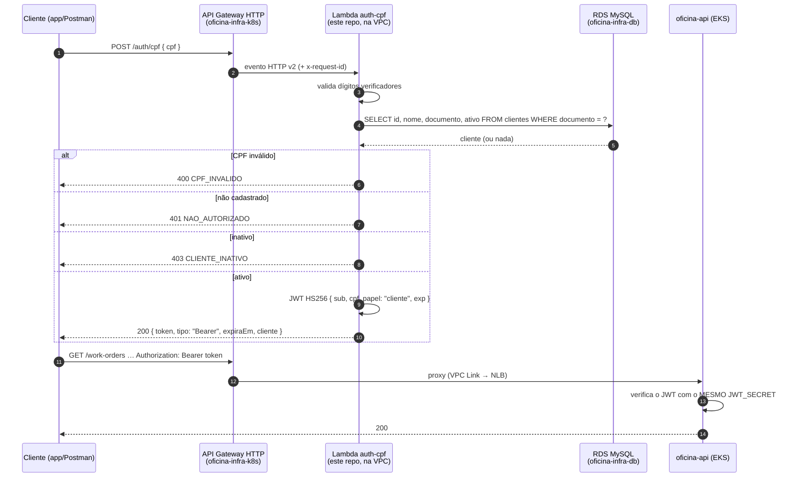
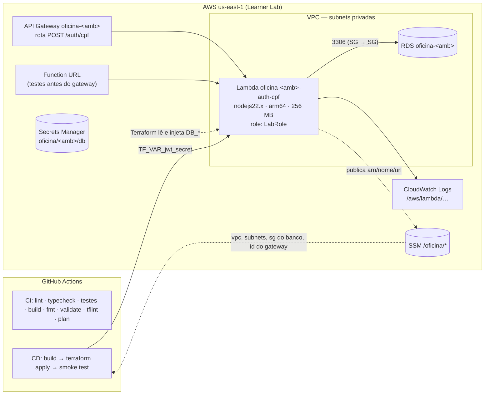

# oficina-auth-lambda — Function Serverless de autenticação por CPF

Repositório **1 de 4** do Tech Challenge FIAP SOAT (Fase 3). Uma **AWS Lambda** (Node.js 22 +
TypeScript) que autentica o **cliente** da oficina mecânica pelo **CPF**: valida os dígitos
verificadores, consulta existência e **status** do cliente no banco gerenciado (RDS MySQL) e
devolve um **JWT** aceito pelas rotas protegidas da API. Exposta como `POST /auth/cpf` no API
Gateway do projeto.

| Repositório | Papel |
| --- | --- |
| **oficina-auth-lambda** (este) | Function Serverless de autenticação por CPF (emite o JWT) |
| [oficina-infra-k8s](https://github.com/Fabio-GST/oficina-infra-k8s) | VPC, EKS, namespaces por ambiente, API Gateway, parâmetros no SSM |
| [oficina-infra-db](https://github.com/Fabio-GST/oficina-infra-db) | RDS MySQL por ambiente, Secrets Manager, modelo de dados |
| [oficina-api](https://github.com/Fabio-GST/oficina-api) | Aplicação principal (AdonisJS) executando no EKS — [Swagger/OpenAPI](https://github.com/Fabio-GST/oficina-api/blob/main/docs/openapi.json) |

Não há Dockerfile: a função é empacotada como **zip** (bundle único gerado pelo esbuild) e
publicada diretamente no runtime gerenciado `nodejs22.x`. Uma imagem de contêiner seria
necessária só acima de 250 MB ou com dependências nativas, o que não é o caso.

## Arquitetura deste repositório





## Estrutura

```
src/
  handler.ts                       # entrada da Lambda (API Gateway HTTP API v2), mapeia HTTP ↔ caso de uso
  dominio/
    cpf.ts                         # validação de CPF (mesma regra do VO Documento da API)
    cliente.ts                     # projeção do cliente e porta do repositório
    autenticar-por-cpf.ts          # caso de uso: valida → consulta → emite token (sem HTTP/AWS)
  infra/
    config.ts                      # variáveis de ambiente
    clientes-repositorio-mysql.ts  # mysql2 com pool reaproveitado entre invocações
    jwt.ts                         # EmissorJwt — contrato com a API
tests/                             # vitest: cpf, jwt (contrato) e handler com repositório fake
scripts/invocar-local.ts           # invoca o handler localmente contra um MySQL
terraform/                         # Lambda, SG, rota no gateway, SSM
.github/workflows/                 # ci.yml e cd.yml
```

## Contrato do endpoint

`POST /auth/cpf` — `Content-Type: application/json`

```json
{ "cpf": "111.444.777-35" }
```

| Status | Corpo | Quando |
| --- | --- | --- |
| `200` | `{ "token": "<jwt>", "tipo": "Bearer", "expiraEm": "2026-…Z", "cliente": { "id", "nome" } }` | CPF válido, cliente cadastrado e ativo |
| `400` | `{ "erro": "CPF_INVALIDO", "mensagem": "…" }` ou `CORPO_INVALIDO` | CPF ausente, com tamanho errado, dígitos verificadores inválidos ou corpo que não é JSON |
| `401` | `{ "erro": "NAO_AUTORIZADO", "mensagem": "CPF não cadastrado." }` | CPF válido mas inexistente em `clientes` |
| `403` | `{ "erro": "CLIENTE_INATIVO", … }` | `clientes.ativo = false` |
| `405` | `{ "erro": "METODO_NAO_PERMITIDO" }` | Método diferente de POST (só pela Function URL) |
| `500` | `{ "erro": "ERRO_INTERNO" }` | Falha ao consultar o banco (detalhe só no log) |

Toda resposta devolve `x-request-id` (o do API Gateway, quando presente). Os logs são JSON
estruturado com `requestId`, `rota`, `status`, `duracaoMs`, `resultado` e o CPF **mascarado**
(`*********35`).

> Decisão: 401 e 403 são distintos para a demonstração deixar explícito o status do cliente.
> Em produção, ambos poderiam colapsar em 401 para não revelar quais CPFs existem; o
> throttling do API Gateway (50 req/s) mitiga enumeração. Registrado na RFC 0003 da API.

### JWT emitido (contrato com a API)

Assinado em **HS256** com o mesmo `JWT_SECRET` da `oficina-api`. Claims exatamente:

```json
{ "sub": "<id do cliente>", "cpf": "11144477735", "papel": "cliente", "iat": 1760000000, "exp": 1760003600 }
```

O teste [`tests/jwt.spec.ts`](./tests/jwt.spec.ts) daqui e o `tests/unit/contrato-jwt.spec.ts`
da API verificam o mesmo formato; se um mudar, o outro quebra.

### CPFs do seed da API para demonstração

| CPF | Cliente | Resultado |
| --- | --- | --- |
| `111.444.777-35` | Maria Silva (ativa) | `200` + token |
| `529.982.247-25` | João Souza (ativo) | `200` + token |
| `123.456.789-09` | Carlos Inativo | `403` |
| `111.444.777-36` | — | `400` (dígito verificador) |

## Tecnologias

- **Node.js 22**, **TypeScript 5**, **esbuild** (bundle CJS único), **vitest** (32 testes), **eslint**
- `jsonwebtoken` (HS256) e `mysql2/promise` (pool reaproveitado entre invocações)
- **AWS Lambda** `nodejs22.x` arm64 na VPC, **API Gateway HTTP API** (integração `AWS_PROXY` v2),
  **Function URL**, **CloudWatch Logs**, **SSM Parameter Store**, **Secrets Manager**
- **Terraform** ≥ 1.5 (providers `aws` 5.x, `archive` 2.x), estado em S3 + DynamoDB
- **GitHub Actions**

## Adaptações ao AWS Academy Learner Lab

| Limitação do lab | O que foi feito |
| --- | --- |
| Não cria roles IAM | Execution role é a **`LabRole`** existente (`data "aws_iam_role"`). A permissão para o API Gateway invocar a função é *resource-based* (`aws_lambda_permission`), permitida. |
| Sem NAT Gateway (custo) → Lambda na VPC não acessa a internet nem o Secrets Manager | Credenciais do banco e `JWT_SECRET` vão como **variáveis de ambiente** da função (criptografadas em repouso), preenchidas pelo Terraform a partir do segredo `oficina/<amb>/db` e do secret `JWT_SECRET` do GitHub. Evolução: VPC endpoint do Secrets Manager e leitura em tempo de execução. |
| Credenciais temporárias, expiram a cada sessão | Pipelines usam `AWS_ACCESS_KEY_ID` / `AWS_SECRET_ACCESS_KEY` / `AWS_SESSION_TOKEN` renovados pelo script [`atualizar-credenciais-aws.sh`](https://github.com/Fabio-GST/oficina-infra-k8s/blob/main/scripts/atualizar-credenciais-aws.sh) do repo `oficina-infra-k8s`. |
| Região | `us-east-1` fixa. |

Custo: Lambda e API Gateway HTTP ficam dentro do free tier para o volume da demonstração;
os ENIs da VPC não são cobrados. A função pode permanecer de pé entre sessões.

## Pré-requisitos

1. `oficina-infra-k8s` aplicado (VPC e subnets no SSM; gateway se `HABILITAR_GATEWAY=true`).
2. `oficina-infra-db` aplicado (SG do banco em `/oficina/<amb>/db/sg-id` e segredo `oficina/<amb>/db`).
3. No GitHub, environments `hml` e `prod` com os secrets `AWS_*` e **`JWT_SECRET`** (o mesmo
   valor configurado no CD da `oficina-api`), e variáveis do repositório `TF_STATE_BUCKET`,
   `TF_LOCK_TABLE`; opcionais `AMBIENTES` (JSON) e `HABILITAR_GATEWAY`.

## Execução local

```bash
npm ci
npm run lint && npm run typecheck && npm test
npm run build            # gera dist/index.js
```

Invocar o handler contra o MySQL do `docker compose up` do repo `oficina-api` (que já aplica
migrações e seeds):

```bash
cp .env.example .env     # JWT_SECRET igual ao da API local
npm run local -- 111.444.777-35
```

Ou, com a função publicada, pela Function URL (saída `urls_funcao` do Terraform ou SSM
`/oficina/hml/auth/url`):

```bash
curl -s -X POST "$(aws ssm get-parameter --name /oficina/hml/auth/url --query Parameter.Value --output text)" \
  -H 'content-type: application/json' -d '{"cpf":"111.444.777-35"}' | jq
```

## Deploy

Manual:

```bash
npm ci && npm run build
cd terraform
cp backend.hcl.example backend.hcl && cp terraform.tfvars.example terraform.tfvars   # ajuste bucket e jwt_secret
terraform init -backend-config=backend.hcl
terraform apply
```

Pelo CI/CD:

| Evento | Workflow | O que faz |
| --- | --- | --- |
| Pull request para `homolog` ou `main` | [`ci.yml`](./.github/workflows/ci.yml) | lint, typecheck, testes com cobertura, build; `terraform fmt`/`validate`/`tflint`; `plan` comentado no PR (pulado sem os secrets do lab) |
| Push em `homolog` | [`cd.yml`](./.github/workflows/cd.yml), environment **hml** | build, verificação dos pré-requisitos no SSM, `terraform apply`, **smoke test** invocando a função com os CPFs do seed (200 / 403 / 400) |
| Push em `main` | `cd.yml`, environment **prod** | Idem, sob as aprovações do environment `prod` |
| Manual | `cd.yml` com `destruir = true` | `terraform destroy` |

`main` e `homolog` são protegidas: sem commits diretos, merge só por pull request com o CI verde.

Ordem de ativação da rota no gateway: (1) `oficina-api` publica o NLB; (2) `oficina-infra-k8s`
aplica com `habilitar_gateway = true`; (3) este repo aplica com `HABILITAR_GATEWAY=true`, que
cria a rota `POST /auth/cpf` no gateway de cada ambiente. Antes disso a Function URL já permite
testar a autenticação.

## Contrato publicado no SSM

| Parâmetro | Conteúdo |
| --- | --- |
| `/oficina/<amb>/auth/lambda-arn`, `/oficina/<amb>/auth/lambda-nome` | Identificação da função (usada pelo smoke test) |
| `/oficina/<amb>/auth/url` | Function URL (se habilitada) |

## Swagger / Postman

A rota `POST /auth/cpf` está documentada no OpenAPI da aplicação, servido pelo gateway em `/docs`
e versionado em [`oficina-api/docs/openapi.json`](https://github.com/Fabio-GST/oficina-api/blob/main/docs/openapi.json),
junto com as rotas protegidas que consomem o token. A collection Postman do projeto usa a variável
`{{gateway_url}}` e um request de login por CPF que grava o token para as demais chamadas.
